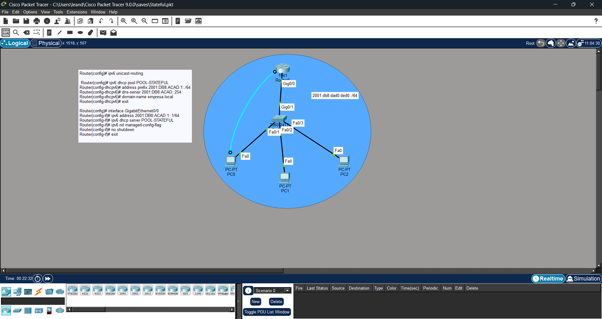
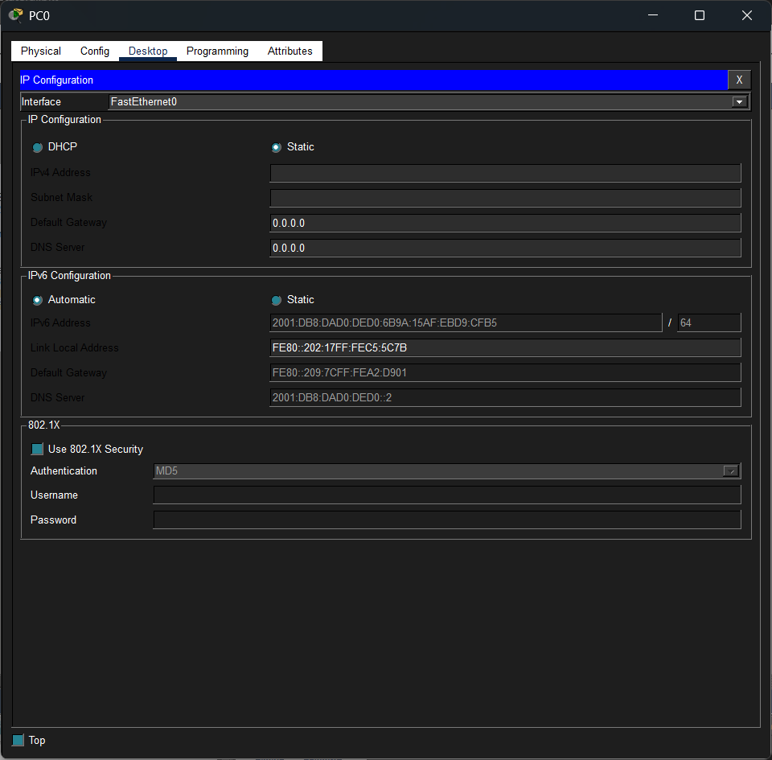
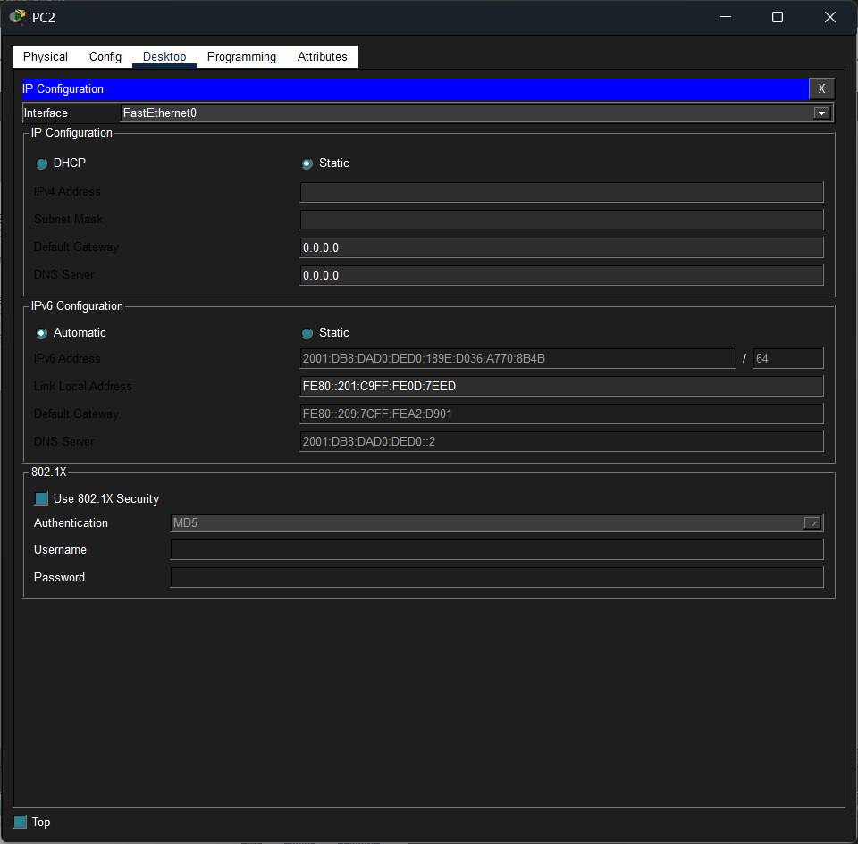
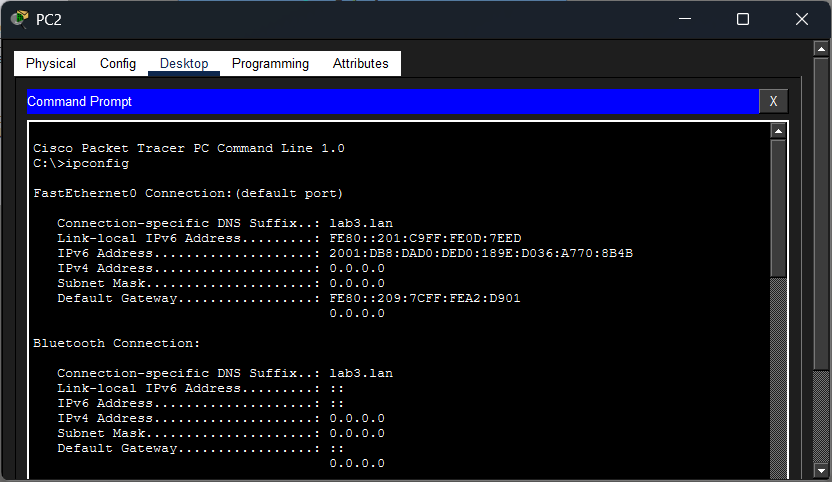
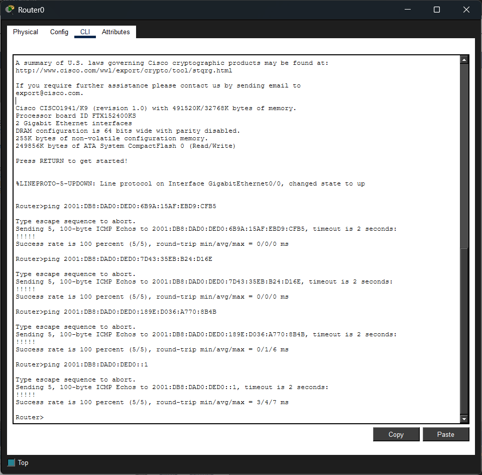
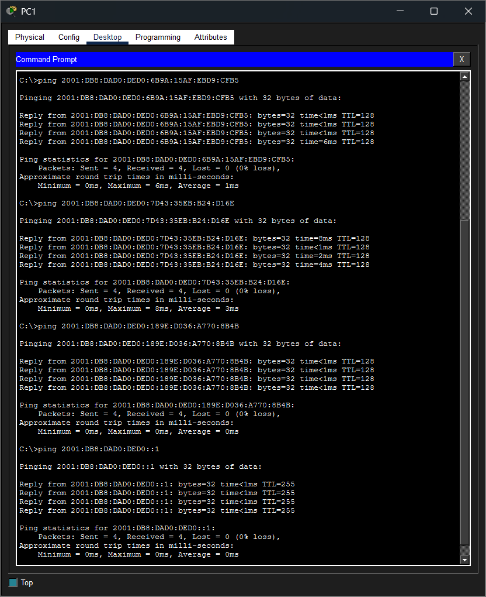

# Configuração de DHCPv6 Stateful

## Sobre o projeto

Projeto prático desenvolvido no Cisco Packet Tracer, com o objetivo de implementar e testar a configuração de DHCPv6 Stateful em uma rede IPv6.

A configuração permite que os computadores recebam automaticamente seus endereços IPv6 globais (GUA) e informações de DNS por meio de um servidor DHCPv6 configurado no roteador.

Topologia da rede

## Topologia da rede

A topologia é composta por:

- 1 roteador Cisco 1941.
- 1 switch Cisco 2960.
- 3 computadores.
- 1 rede IPv6.

Configurações realizadas

- Habilitação do roteamento IPv6 no roteador.
- Criação do pool DHCPv6 Stateful "POOL-STATEFUL".
- Configuração do prefixo IPv6 "2001:DB8:DAD0:DED0::/64".
- Configuração do domínio "lab3.lan".
- Atribuição do endereço GUA "2001:DB8:DAD0:DED0::1/64" à interface GigabitEthernet0/0.
- Associação do pool DHCPv6 à interface.
- Configuração da flag Managed (M), indicando aos clientes que devem obter os endereços por DHCPv6.

Funcionamento do DHCPv6 Stateful

No modo Stateful, o servidor DHCPv6 realiza a atribuição dos endereços IPv6 globais (GUA) aos computadores.

O gateway padrão é aprendido separadamente, por meio de Router Advertisements (RA), utilizando o endereço Link-Local (LLA) do roteador.

Testes realizados

Foram realizados testes para verificar:

- Recebimento automático de endereços IPv6 pelos computadores.
- Configuração de endereços GUA e gateway padrão.
- Conectividade entre os computadores por meio de testes "ping".
- Testes de conectividade IPv6 realizados diretamente pelo roteador.

Tecnologias e conceitos utilizados

- Cisco Packet Tracer.
- IPv6.
- DHCPv6 Stateful.
- Global Unicast Address (GUA).
- Link-Local Address (LLA).
- Router Advertisement (RA).
- ICMPv6.

## Arquivo do projeto

[Baixar projeto DHCPv6 Stateful](DStateful.pkt)

Competências desenvolvidas

- Configuração de redes IPv6.
- Implementação de DHCPv6 Stateful.
- Configuração de roteadores Cisco.
- Testes e diagnóstico de conectividade.

---

Projeto desenvolvido para fins de estudo e prática em redes de computadores.
